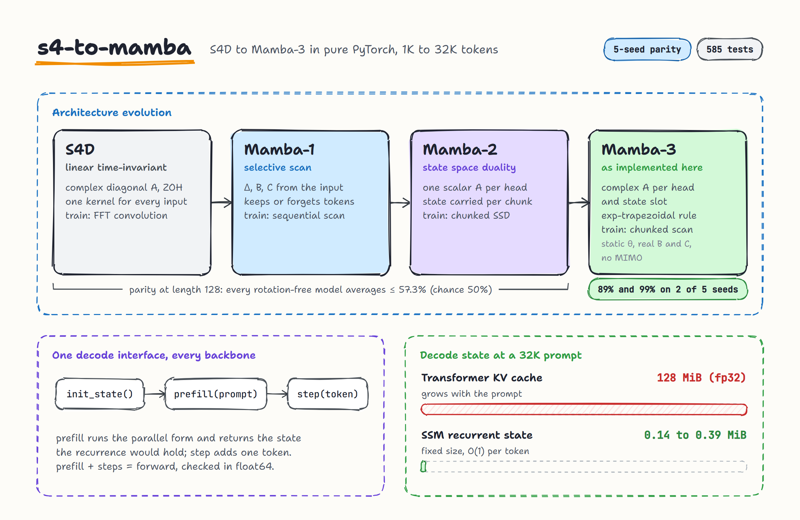
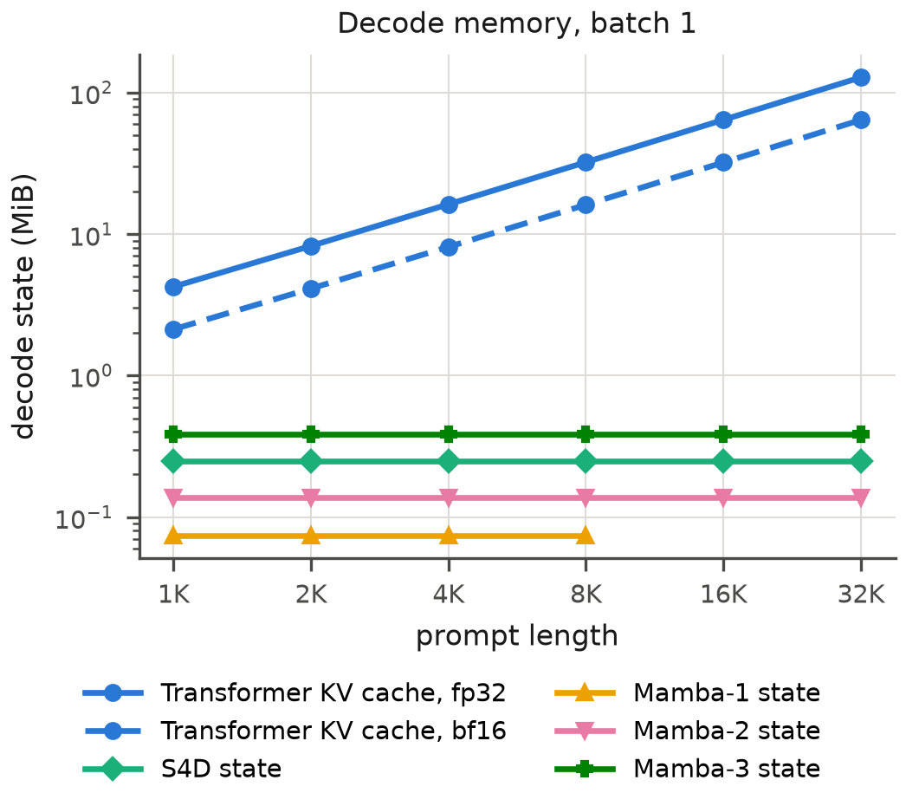
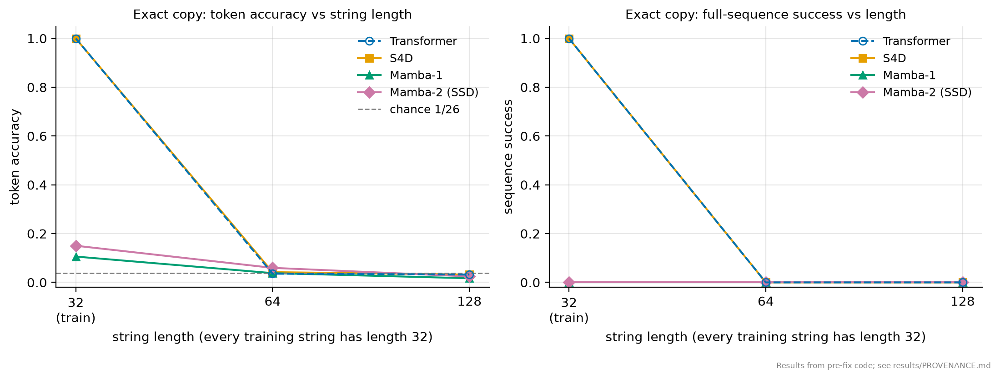
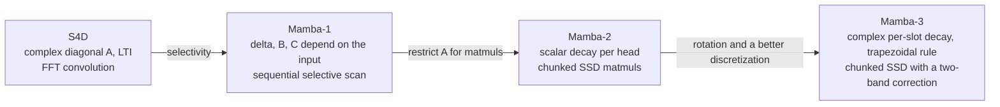
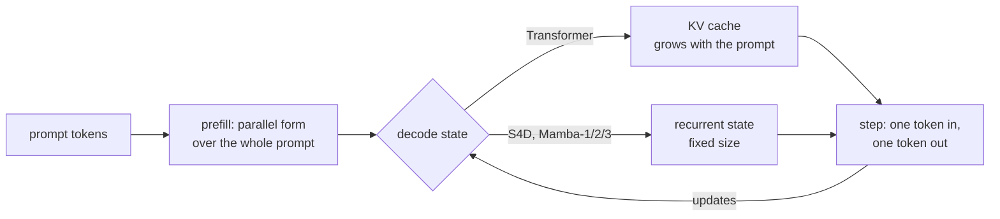
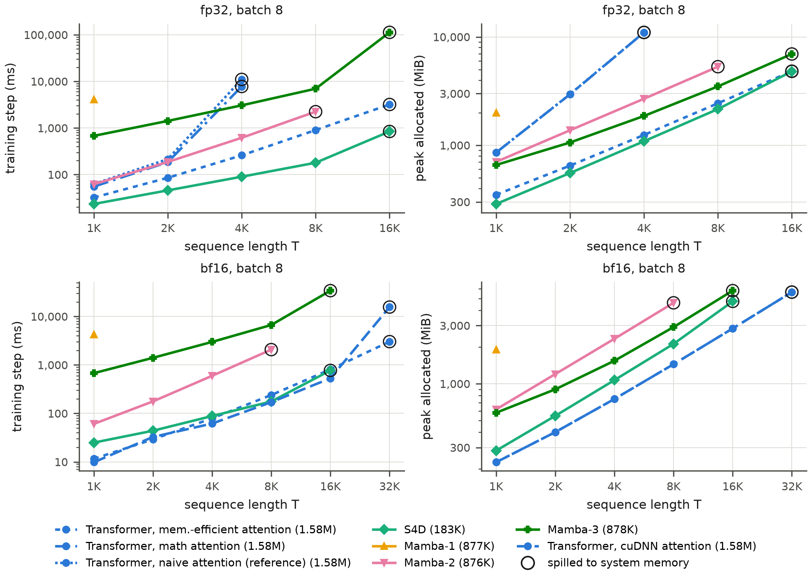
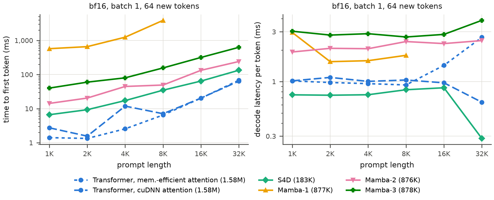
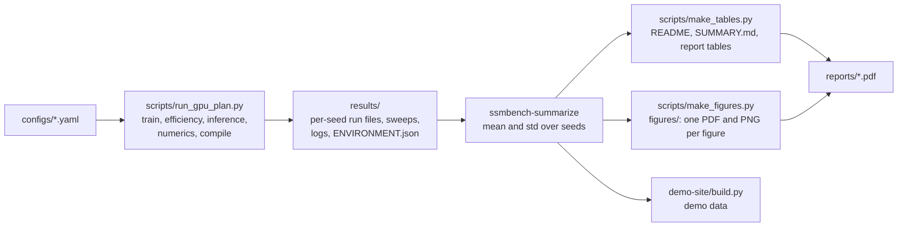

# Efficient Long-Context Sequence Modeling: From S4 to Mamba-3

[](https://github.com/vaibhav3000/s4-to-mamba/actions/workflows/ci.yml)

Five sequence backbones (a causal Transformer, S4D, Mamba-1, Mamba-2 and Mamba-3) written
from first principles in plain PyTorch behind one decode interface, compared with matched
parameters and three to five seeds, and benchmarked on one 6 GB laptop GPU. Every number
below is generated from the committed result files by `scripts/make_tables.py`.



## System Walkthrough (30-Second Overview)

- **Architecture evolution.** *S4D* (linear time-invariant) runs one kernel for every input
  and trains as an FFT convolution; *Mamba-1* (selective scan) computes Δ, B and C from the
  input, so it keeps or forgets tokens; *Mamba-2* (state space duality) uses one scalar A per
  head and trains as a chunked SSD; *Mamba-3*, as implemented here, has a complex A per head
  and state slot, the exp-trapezoidal rule and a chunked scan, with static θ, real B and C and
  no MIMO.
- **The parity bracket.** At length 128 every rotation-free model averages at most 57.3%
  (chance 50%); only Mamba-3's rotation learns the task, reaching 89% and 99% on 2 of 5 seeds.
- **One decode interface, every backbone.** `init_state()`, then `prefill(prompt)`, then
  `step(token)`: prefill runs the parallel form and returns the state the recurrence would
  hold, step adds one token, and prefill plus steps equals forward, checked in float64.
- **Decode state at a 32K prompt.** The Transformer KV cache grows with the prompt to 128 MiB
  (fp32), while the SSM recurrent state stays a fixed 0.14 to 0.39 MiB, O(1) per token.

## What the runs show

Three run seeds per task, five on parity.

- Parity at length 128: Mamba-3 has the best mean, 72.6 ± 20.5% token accuracy,
  but only two of its five seeds learn the task (89.2 and 99.0%). With its rotation
  removed it falls to 55.4 ± 1.2%, close to Mamba-1 and Mamba-2; the Transformers
  and S4D stay near chance. No model extrapolates to longer sequences.
- Selective copying: the selective SSMs and the Transformers solve it in
  distribution (98 to 100%) and LTI S4D does not (28.4%). With twice the length and
  pairs, Mamba-1 and Mamba-2 keep about half the answers, while Mamba-3 (14.4%) and
  the Transformers (7.5 to 12.1%) collapse.
- Exact copying on lengths 1 to 32: the Transformers copy best (98.6% at length 32
  with RoPE), Mamba-3 is the best SSM (61.4%), and nobody generalizes to 64.
- IMDb: all models lie between 81.6 and 84.5% (Mamba-2 best).
- Inference: after a 32K prompt the SSM decode states take 0.14 to 0.39 MiB, the
  Transformer's KV cache 64 MiB in bf16; fused attention still gives the fastest
  bf16 prefill at every length.

### Headline figures


*Parity: only Mamba-3, whose complex transition rotates the state, has runs that learn the task
(2 of 5 seeds), and without rotation it stays with Mamba-1/2. Mean ± one sample std, n = 5; dots are seeds.*



*Decode memory: the Transformer's KV cache grows linearly with the prompt (64 MiB in bf16 at 32K),
while every SSM keeps a fixed 0.07 to 0.39 MiB state. Measured in the fp32 and bf16 inference sweeps.*



*Exact copy: at a single training length copying is a fixed delay that even LTI S4D solves; over
lengths 1 to 32 attention copies best and Mamba-3 leads the SSMs. Nothing generalizes past 32 (n = 3).*

The full write-up is
[reports/Efficient_Sequence_Modeling_S4_to_Mamba3.pdf](reports/Efficient_Sequence_Modeling_S4_to_Mamba3.pdf);
the design behind this version is in [docs/design/step2.md](docs/design/step2.md) and
the decisions in [docs/adr/](docs/adr/).

## The five implementations

| Model | Transition | Parallel form | Decode |
|---|---|---|---|
| `transformer_minimal` | none; sinusoidal or RoPE positions | causal SDPA with the backend pinned per variant, or a naive reference | preallocated KV cache |
| `s4_minimal` (S4D) | complex diagonal, LTI, ZOH | FFT convolution | complex state, O(1) |
| `mamba_minimal` | real diagonal, input-dependent, exponential Euler | sequential selective scan | state plus conv history, O(1) |
| `mamba2_minimal` | scalar per head, exponential Euler | chunked SSD | state plus conv history, O(1) |
| `mamba3_minimal` | complex diagonal per head and state slot, exponential trapezoidal | chunked complex SSD with a two-band correction | complex state, boundary input and conv history, O(1) |



Every backbone implements `init_state`, `prefill` (the parallel form, returning the
state a recurrence would hold) and `step`. The Mamba-3 chunked form unrolls the
trapezoidal recurrence into decayed products with two-band input weights; the
derivation is in docs/design/step2.md section 3.4 and
[docs/adr/0002](docs/adr/). The Mamba-3 here has static rotation frequencies, real
B and C with a real-part readout, and no MIMO.



`prefill` returns exactly the state the recurrence would hold after the prompt, so
`prefill` followed by `step` reproduces `forward` (tested in float64 for every backbone).

The CPU test suite checks, among other things: prefill plus single steps against the
full forward pass for every backbone in float64 at 1e-10; the chunked Mamba-3 against
its recurrence in float64 (values, final state and all gradients, chunk sizes 1 to 64,
underflowing decays) plus `gradcheck`; RoPE against an independent complex rotation;
the attention backends against each other; bitwise-identical training for equal seeds
and after resuming from a checkpoint; and that the timed generation produces exactly
the tokens of greedy decoding by repeated full forwards.

## Protocol

Per task, the Transformer keeps its width and depth, and each SSM gets the width on
its constraint grid whose parameter count is closest (all within 10%;
`scripts/match_params.py`). A run seed sets initialization, dropout and batch order;
a separate data seed fixes the datasets, so every run sees the same examples. Training
uses deterministic algorithms, validation drives the per-epoch history, and the test
sets are scored once after the last epoch. The Transformers train with the
memory-efficient SDPA kernel; the kernel that ran is detected from a profiler trace
and stored with each result. Mamba-1 is not trained on IMDb, where its sequential scan
over 512 tokens is too slow on this GPU.

## Results

Mean ± sample standard deviation over run seeds 0 to 2 (0 to 4 for parity).

### Parity (state tracking) and the rotation ablation

<!-- generated:parity -->
| Model | Parameters | T=128 | T=256 | T=512 | T=1024 | T=2048 |
|---|---|---|---|---|---|---|
| Transformer (sinusoidal) | 100,354 | 52.5 ± 0.9 | 51.3 ± 0.4 | 50.6 ± 0.2 | 50.3 ± 0.1 | 50.2 ± 0.1 |
| Transformer (RoPE) | 100,354 | 51.7 ± 0.2 | 50.9 ± 0.1 | 50.4 ± 0.1 | 50.2 ± 0.0 | 50.1 ± 0.0 |
| S4D | 101,034 | 50.9 ± 0.5 | 50.4 ± 0.2 | 50.1 ± 0.1 | 50.1 ± 0.1 | 50.1 ± 0.0 |
| Mamba-1 | 99,902 | 57.3 ± 2.3 | 53.8 ± 1.2 | 51.8 ± 0.7 | 50.9 ± 0.3 | 50.5 ± 0.1 |
| Mamba-2 | 101,672 | 56.8 ± 2.7 | 53.4 ± 1.4 | 51.6 ± 0.8 | 50.8 ± 0.4 | 50.4 ± 0.2 |
| Mamba-3 | 102,642 | 72.6 ± 20.5 | 61.7 ± 10.7 | 55.8 ± 5.5 | 52.9 ± 2.8 | 51.5 ± 1.3 |
| Mamba-3, no rotation | 102,322 | 55.4 ± 1.2 | 52.8 ± 0.7 | 51.2 ± 0.3 | 50.6 ± 0.2 | 50.4 ± 0.1 |

token accuracy in percent, mean ± sample std over n = 5 run seeds; chance 50.0.
<!-- /generated:parity -->


### Selective copying

In distribution: T=64 with 3 to 5 marker-value pairs. Out of distribution: T=128 with
5 to 10 pairs.

<!-- generated:selective_copy -->
| Model | Parameters | id | ood |
|---|---|---|---|
| Transformer (sinusoidal) | 401,940 | 100.0 ± 0.0 | 12.1 ± 1.9 |
| Transformer (RoPE) | 401,940 | 100.0 ± 0.0 | 7.5 ± 0.9 |
| S4D | 402,996 | 28.4 ± 6.7 | 17.6 ± 3.4 |
| Mamba-1 | 398,180 | 99.3 ± 1.3 | 52.1 ± 20.4 |
| Mamba-2 | 365,900 | 98.3 ± 2.9 | 49.6 ± 17.9 |
| Mamba-3 | 367,190 | 99.1 ± 1.6 | 14.4 ± 6.3 |

answer-token accuracy in percent, mean ± sample std over n = 3 run seeds; chance 5.9.
<!-- /generated:selective_copy -->

### Exact copying

Trained at the single string length 32:

<!-- generated:exact_copy -->
| Model | Parameters | L=16 | L=32 | L=64 | L=128 |
|---|---|---|---|---|---|
| Transformer (sinusoidal) | 602,782 | 8.7 ± 3.7 | 100.0 ± 0.0 | 3.6 ± 0.5 | 3.6 ± 0.3 |
| Transformer (RoPE) | 602,782 | 3.4 ± 0.4 | 100.0 ± 0.0 | 3.9 ± 0.2 | 3.5 ± 0.5 |
| S4D | 604,102 | 3.0 ± 0.8 | 100.0 ± 0.0 | 4.6 ± 0.7 | 2.7 ± 0.3 |
| Mamba-1 | 597,102 | 10.1 ± 1.7 | 21.8 ± 8.1 | 5.1 ± 0.4 | 1.6 ± 0.5 |
| Mamba-2 | 548,690 | 16.8 ± 2.2 | 23.5 ± 2.0 | 7.1 ± 1.6 | 3.0 ± 0.9 |
| Mamba-3 | 550,625 | 2.5 ± 0.3 | 100.0 ± 0.0 | 3.6 ± 0.5 | 2.8 ± 0.8 |

token accuracy in percent, mean ± sample std over n = 3 run seeds; chance 3.8.
<!-- /generated:exact_copy -->

Trained on lengths 1 to 32:

<!-- generated:exact_copy_varlen -->
| Model | Parameters | L=16 | L=32 | L=64 | L=128 |
|---|---|---|---|---|---|
| Transformer (sinusoidal) | 602,782 | 100.0 ± 0.0 | 87.4 ± 3.7 | 5.0 ± 0.4 | 4.0 ± 0.2 |
| Transformer (RoPE) | 602,782 | 100.0 ± 0.0 | 98.6 ± 0.7 | 6.4 ± 1.1 | 4.1 ± 0.3 |
| S4D | 604,102 | 21.4 ± 0.5 | 19.7 ± 1.0 | 5.9 ± 0.6 | 3.2 ± 0.7 |
| Mamba-1 | 597,102 | 62.6 ± 11.9 | 35.6 ± 8.3 | 13.1 ± 3.2 | 5.0 ± 0.9 |
| Mamba-2 | 548,690 | 50.0 ± 5.4 | 29.0 ± 2.4 | 12.4 ± 1.8 | 4.8 ± 0.9 |
| Mamba-3 | 550,625 | 80.2 ± 4.1 | 61.4 ± 5.7 | 5.8 ± 3.1 | 3.8 ± 0.5 |

token accuracy in percent, mean ± sample std over n = 3 run seeds; chance 3.8.
<!-- /generated:exact_copy_varlen -->

A string of fixed length is a fixed delay, which S4D's convolution represents
exactly; once lengths vary, S4D falls to 19.7% at length 32.

### IMDb sentiment

12,500 training reviews truncated at 512 tokens, 2,500 held out for validation, the
25,000-review test split for testing; dataset revision pinned.

<!-- generated:imdb -->
| Model | Parameters | test |
|---|---|---|
| Transformer (sinusoidal) | 3,353,602 | 81.6 ± 0.2 |
| Transformer (RoPE) | 3,353,602 | 81.9 ± 0.6 |
| S4D | 3,367,682 | 83.7 ± 0.2 |
| Mamba-2 | 3,034,786 | 84.5 ± 0.1 |
| Mamba-3 | 3,036,850 | 82.5 ± 1.2 |

test accuracy in percent, mean ± sample std over n = 3 run seeds; chance 50.0; the single test set is the 25k IMDb test split.
<!-- /generated:imdb -->

### Training step (batch 8)

Language-model wrappers of width 256 and two layers: equal width, not equal parameters
(Transformer 1,579,520, S4D 182,784, Mamba-1/2/3 875,808 to 877,872; the Parameters
column), so compare each model's growth with length rather than ratios between models. A
spilled point ran past free GPU memory and was paged to system memory
by the Windows display driver, so its time is not a GPU-resident measurement.

<!-- generated:efficiency_fp32 -->
| Model | Parameters | T=1024 | T=2048 | T=4096 | T=8192 | T=16384 | T=32768 |
|---|---|---|---|---|---|---|---|
| Transformer, mem.-efficient attention | 1,579,520 | 32.2 / 349 | 85.4 / 649 | 259.0 / 1245 | 903.1 / 2440 | 3194.8 / 4830 (spilled) | skipped |
| Transformer, math attention | 1,579,520 | 55.2 / 855 | 185.0 / 2953 | 7778.9 / 10990 (spilled) | - | - | - |
| Transformer, naive attention (reference) | 1,579,520 | 62.8 / 857 | 214.4 / 2961 | 11031.4 / 11022 (spilled) | - | - | - |
| S4D | 182,784 | 23.4 / 287 | 45.8 / 554 | 90.1 / 1089 | 179.6 / 2158 | 842.0 / 4808 (spilled) | skipped |
| Mamba-1 | 876,544 | 4095.4 / 1993 | - | - | - | - | - |
| Mamba-2 | 875,808 | 62.1 / 703 | 186.8 / 1375 | 616.3 / 2688 | 2240.8 / 5313 (spilled) | skipped | skipped |
| Mamba-3 | 877,872 | 677.8 / 658 | 1418.2 / 1061 | 3061.9 / 1864 | 6963.8 / 3494 | 112812.1 / 6960 (spilled) | skipped |

fp32, batch 8: median training-step time in ms / peak allocated MiB. spilled: the step ran past free GPU memory (WDDM paging, not a VRAM number); skipped: not run after a shorter length spilled; unsupported: the pinned attention kernel refused the inputs; -: not in the sweep. Parameters: backbone only, every model at width 256 and two layers, so the counts are not matched and no ratio of timings is like for like.
<!-- /generated:efficiency_fp32 -->

<!-- generated:efficiency_bf16 -->
| Model | Parameters | T=1024 | T=2048 | T=4096 | T=8192 | T=16384 | T=32768 |
|---|---|---|---|---|---|---|---|
| Transformer, FlashAttention | - | unsupported | unsupported | unsupported | unsupported | unsupported | unsupported |
| Transformer, mem.-efficient attention | 1,579,520 | 11.6 / 227 | 29.2 / 401 | 79.3 / 750 | 239.4 / 1446 | 808.1 / 2840 | 3025.5 / 5642 (spilled) |
| S4D | 182,784 | 25.0 / 283 | 43.9 / 546 | 88.3 / 1071 | 176.2 / 2122 | 770.9 / 4736 (spilled) | skipped |
| Mamba-1 | 876,544 | 4235.9 / 1905 | - | - | - | - | - |
| Mamba-2 | 875,808 | 60.7 / 616 | 176.9 / 1200 | 597.0 / 2337 | 2070.4 / 4610 (spilled) | skipped | skipped |
| Mamba-3 | 877,872 | 676.3 / 578 | 1402.4 / 900 | 2986.1 / 1543 | 6674.0 / 2915 | 34101.2 / 5801 (spilled) | skipped |
| Transformer, cuDNN attention | 1,579,520 | 9.8 / 227 | 32.7 / 401 | 61.7 / 750 | 170.6 / 1446 | 530.0 / 2840 | 15630.3 / 5642 (spilled) |

bf16, batch 8: median training-step time in ms / peak allocated MiB. spilled: the step ran past free GPU memory (WDDM paging, not a VRAM number); skipped: not run after a shorter length spilled; unsupported: the pinned attention kernel refused the inputs; -: not in the sweep. Parameters: backbone only, every model at width 256 and two layers, so the counts are not matched and no ratio of timings is like for like.
<!-- /generated:efficiency_bf16 -->



Without fused kernels, Mamba-2's chunked SSD (875,808 parameters) is slower than fused
attention (1,579,520 parameters) at every length it reaches, and Mamba-3's chunked form costs 5 to 11 times Mamba-2 because it
builds a decay tensor per state slot. FlashAttention is not built into the Windows
torch wheel, so it is reported as unsupported.

### Generation (batch 1, 64 new tokens)

<!-- generated:inference_fp32 -->
| Model | Parameters | T=1024 | T=2048 | T=4096 | T=8192 | T=16384 | T=32768 |
|---|---|---|---|---|---|---|---|
| Transformer, mem.-efficient attention | 1,579,520 | 1.5 / 0.98 | 3.2 / 0.96 | 8.7 / 1.32 | 27.0 / 2.46 | 93.4 / 4.61 | 364.2 / 9.26 |
| S4D | 182,784 | 14.9 / 2.02 | 19.9 / 2.37 | 21.8 / 2.48 | 36.1 / 2.52 | 69.4 / 1.81 | 144.4 / 0.55 |
| Mamba-1 | 876,544 | 857.6 / 3.28 | 1700.6 / 3.59 | 1429.5 / 1.32 | 3153.2 / 2.42 | - | - |
| Mamba-2 | 875,808 | 27.0 / 6.22 | 49.1 / 5.88 | 99.1 / 6.77 | 96.5 / 3.67 | 171.9 / 3.60 | 345.1 / 3.46 |
| Mamba-3 | 877,872 | 49.3 / 4.87 | 56.7 / 4.96 | 87.5 / 4.80 | 156.4 / 1.91 | 313.1 / 1.90 | 629.6 / 1.89 |

fp32, batch 1: median time to first token in ms / median decode latency per token in ms, prompt length T, 64 new tokens. Decode state at the longest measured prompt: Transformer, mem.-efficient attention 128.25 MiB at T=32768; S4D 0.25 MiB at T=32768; Mamba-1 0.07 MiB at T=8192; Mamba-2 0.14 MiB at T=32768; Mamba-3 0.39 MiB at T=32768. Parameters: backbone only, every model at width 256 and two layers, so the counts are not matched and no ratio of timings is like for like.
<!-- /generated:inference_fp32 -->

<!-- generated:inference_bf16 -->
| Model | Parameters | T=1024 | T=2048 | T=4096 | T=8192 | T=16384 | T=32768 |
|---|---|---|---|---|---|---|---|
| Transformer, FlashAttention | - | unsupported | unsupported | unsupported | unsupported | unsupported | unsupported |
| Transformer, mem.-efficient attention | 1,579,520 | 1.4 / 1.01 | 1.3 / 0.98 | 2.6 / 0.96 | 6.5 / 0.93 | 20.3 / 1.43 | 68.1 / 2.65 |
| Transformer, cuDNN attention | 1,579,520 | 2.7 / 1.02 | 1.6 / 1.10 | 11.8 / 1.00 | 7.1 / 1.04 | 20.4 / 0.97 | 64.1 / 0.63 |
| S4D | 182,784 | 6.6 / 0.75 | 9.3 / 0.74 | 17.2 / 0.75 | 34.7 / 0.84 | 64.3 / 0.87 | 133.7 / 0.29 |
| Mamba-1 | 876,544 | 572.7 / 2.95 | 656.9 / 1.55 | 1244.5 / 1.59 | 3878.3 / 1.78 | - | - |
| Mamba-2 | 875,808 | 14.2 / 1.92 | 20.4 / 2.08 | 44.6 / 2.06 | 49.2 / 2.42 | 133.0 / 2.31 | 240.9 / 2.47 |
| Mamba-3 | 877,872 | 40.0 / 3.04 | 59.8 / 2.79 | 80.0 / 2.88 | 156.1 / 2.67 | 317.0 / 2.83 | 628.0 / 3.86 |

bf16, batch 1: median time to first token in ms / median decode latency per token in ms, prompt length T, 64 new tokens. Decode state at the longest measured prompt: Transformer, FlashAttention -; Transformer, mem.-efficient attention 64.12 MiB at T=32768; Transformer, cuDNN attention 64.12 MiB at T=32768; S4D 0.25 MiB at T=32768; Mamba-1 0.07 MiB at T=8192; Mamba-2 0.14 MiB at T=32768; Mamba-3 0.39 MiB at T=32768. Parameters: backbone only, every model at width 256 and two layers, so the counts are not matched and no ratio of timings is like for like.
<!-- /generated:inference_bf16 -->



The SSM decode steps do the same work at every prompt length; their medians vary
without a trend because a step launches many small kernels from Python, so at batch 1
they measure launch overhead rather than arithmetic.

### Numerics and compilation

<!-- generated:numerics -->
| Model | fp32 vs fp64 | bf16 vs fp64 | fp16 vs fp64 | bf16 decode, max |
|---|---|---|---|---|
| Transformer (sinusoidal) | 1.4e-07 | 1.0e-03 | 1.2e-04 | 1.2e-03 |
| Transformer (RoPE) | 1.4e-07 | 1.2e-03 | 1.4e-04 | 1.3e-03 |
| S4D | 1.1e-07 | 1.3e-03 | 1.7e-04 | 2.0e-03 |
| Mamba-1 | 5.0e-08 | 3.5e-04 | 4.5e-05 | 4.7e-04 |
| Mamba-2 | 5.0e-08 | 3.5e-04 | 4.5e-05 | 4.9e-04 |
| Mamba-3 | 5.0e-08 | 3.5e-04 | 4.5e-05 | 4.4e-04 |

Relative L2 error of the backbone output against float64 at T=4096, mean over 3 initialization seeds; the last column is the largest per-step error of a bf16 decode against the float64 forward pass.
<!-- /generated:numerics -->

The models are randomly initialized, and the residual stream dominates their outputs
(the Mamba blocks change it by about 6%), which is why the three Mamba variants show
nearly the same error.

<!-- generated:compile -->
| Model | Forward graphs / breaks | Step graphs / breaks | aot_eager max diff | Inductor |
|---|---|---|---|---|
| Transformer (sinusoidal) | 1 / 0 | 1 / 0 | 0.0e+00 | not run: Triton is not installed in this environment |
| Transformer (RoPE) | 1 / 0 | 1 / 0 | 0.0e+00 | not run: Triton is not installed in this environment |
| S4D | 1 / 0 | 5 / 4 | 0.0e+00 | not run: Triton is not installed in this environment |
| Mamba-1 | 1 / 0 | 1 / 0 | 0.0e+00 | not run: Triton is not installed in this environment |
| Mamba-2 | 1 / 0 | 1 / 0 | 0.0e+00 | not run: Triton is not installed in this environment |
| Mamba-3 | 1 / 0 | 1 / 0 | 0.0e+00 | not run: Triton is not installed in this environment |

torch.compile readiness: Dynamo graphs and graph breaks, and the largest output or gradient difference of aot_eager against eager.
<!-- /generated:compile -->

S4D's decode step breaks the graph at a `Tensor.item()` call in its parameter-version
check; every other forward and step compiles to one graph.

### Environment

<!-- generated:environment -->
| Item | Value |
|---|---|
| GPU | NVIDIA GeForce RTX 4050 Laptop GPU (6140.5 MiB) |
| NVIDIA driver | 610.74 |
| PyTorch | 2.14.1+cu130 |
| CUDA / cuDNN | 13.0 / 92400 |
| Python | 3.13.7 |
| Platform | Windows-11-10.0.26300-SP0 |
| Code | git c4c111b |
| uv.lock sha256 | c67a82f69221 |

Recorded by scripts/write_environment.py at the start of the GPU runs.
<!-- /generated:environment -->

## Design and decisions

- [docs/design/step2.md](docs/design/step2.md): the design of this version, including the
  Mamba-3 chunked-form derivation.
- [ADR 0001](docs/adr/0001-seeds-vary-training-not-data.md): run seeds vary training, not
  the data.
- [ADR 0002](docs/adr/0002-mamba3-chunked-form-uses-segment-sums.md): the Mamba-3 chunked
  form uses direct segment sums.
- [ADR 0003](docs/adr/0003-decode-is-prefill-then-step.md): decode is prefill, then step.
- [ADR 0004](docs/adr/0004-attention-backend-pinned-and-detected.md): the attention backend
  is pinned and detected.
- [ADR 0005](docs/adr/0005-parameter-matching-by-width.md): parameter matching by width.
- [ADR 0006](docs/adr/0006-numbers-come-from-generated-tables.md): numbers come from
  generated tables.
- [ADR 0007](docs/adr/0007-uv-lock-with-torch-2.14.1-extras.md): a uv lock with torch 2.14.1
  extras.
- [ADR 0008](docs/adr/0008-deterministic-training-runs.md): deterministic training runs.
- [docs/GLOSSARY.md](docs/GLOSSARY.md) defines the terms, and
  [docs/evolution.md](docs/evolution.md) walks through the architectures from S4 to Mamba-3.

## Limitations

- **Parity rests on a minority of seeds.** Mamba-3 learns parity in two of five seeds
  (89.2 and 99.0%); its mean of 72.6 ± 20.5% hides that split. Without rotation no seed
  exceeds 57.2%.
- **Nothing extrapolates in length.** Every model, the Transformers included, is at most
  13.1% beyond the longest training length on exact copying, and every parity mean is 50.1
  to 51.5% at length 2048.
- **The benchmark sweeps are not parameter-matched.** Every benchmark model has width 256
  and two layers, so the Transformer has 1,579,520 parameters, S4D 182,784 and the Mamba
  variants about 876K (the tables list them). No speed or memory ratio between
  architectures in those tables is like for like. The training tasks are matched.
- **Timing is one initialization on one laptop GPU with unlocked clocks.** Each point is a
  median over repeated timed runs within one session; run-to-run variation is not measured,
  and the recorded GPU state shows the clocks dropping into low power states during
  launch-bound decode.
- **No fused kernels.** The scans are plain PyTorch; Inductor was not measured (Triton is
  not available on Windows), and FlashAttention is not in the Windows torch wheel.
- **Small scale.** The models have 0.1M to 3.4M parameters and train for a few epochs.
- **Not implemented:** full S4 (NPLR with a Cauchy kernel), Mamba-3's MIMO formulation and
  input-dependent rotation frequencies.

## Reproducing

The environment is locked with uv (`uv.lock`); torch 2.14.1 comes from the PyTorch CPU or
CUDA 13.0 index through the `cpu` or `cu130` extra
([ADR 0007](docs/adr/0007-uv-lock-with-torch-2.14.1-extras.md)).

```bash
uv sync --locked --extra cpu          # CPU only
uv sync --locked --extra cu130        # CUDA 13.0
make check                            # the CPU gate: ruff, pyright, pytest, tables, lock
```

The Makefile works with GNU Make on Linux and from Git Bash on Windows; `make help` lists
its targets (`setup TORCH=cpu|cu130`, `lint`, `typecheck`, `test`, `check`, `tables`,
`figures`, `report`, `demo`, `gpu-plan`, `docker`).

Entry points, each with `--config configs/<name>.yaml`:

| Command | Does |
|---|---|
| `ssmbench-train` | train one config over `--seeds`, resumable per epoch with `--checkpoints` |
| `ssmbench-summarize` | mean and sample std over seeds into `results/train/<config>/summary.json` |
| `ssmbench-efficiency` | training-step and forward sweep by length, per precision and attention kernel |
| `ssmbench-inference` | time to first token, decode latency, tokens/s and memory by prompt length |
| `ssmbench-numerics` | bf16 and fp16 error against float32 and float64, and decode drift |
| `ssmbench-compile` | `torch.compile` graph breaks and aot_eager equivalence |

Every GPU result comes from one resumable plan; each job writes its log to
`results/logs/<job>.log` and can be rerun on its own:

```bash
uv run python scripts/run_gpu_plan.py --seeds 0 1 2 --dry-run   # list the jobs
uv run python scripts/run_gpu_plan.py --seeds 0 1 2             # run them all
uv run python scripts/run_gpu_plan.py --from summarize          # continue from a job
uv run python scripts/run_gpu_plan.py --seeds 3 4 --only train-parity   # add seeds
```

The jobs are: `environment` (results/ENVIRONMENT.json), `smoke` (two training steps per
variant, twice, which must agree bitwise, and every pinned attention kernel once),
`train-<config>` (`ssmbench-train --seeds 0 1 2 --checkpoints checkpoints`, resumable
per epoch), `summarize`, `efficiency-fp32/bf16`, `inference-fp32/bf16`, `numerics`,
`compile`, `figures` and `tables`. The tables in this README, results/SUMMARY.md and
the report tables are regenerated by `scripts/make_tables.py`; `--check` fails if a
committed table differs from the committed results. Where each result file came from
is in [results/PROVENANCE.md](results/PROVENANCE.md).



## Project structure

```
src/ssmbench/models/      five backbones, attention backends, decode interface
src/ssmbench/data/        parity, selective copy, exact copy, IMDb (pinned revision)
src/ssmbench/train/       trainer (seeds, validation and test sets, checkpoints), CLI
src/ssmbench/benchmarks/  efficiency, inference, numerics and compile benchmarks
src/ssmbench/analysis/    multi-seed summaries and result loading
configs/                  training configs (parameter-matched) and benchmark configs
scripts/                  run plan, smoke check, tables, figures, parameter matching
results/                  per-seed runs, summaries, sweeps, logs, environment, provenance
reports/                  LaTeX report, generated tables and figures
docs/                     design (docs/design/step2.md), ADRs, glossary, notes
tests/                    references, equivalence, gradient, decode and protocol tests
legacy/                   the original project's scripts, preserved with notes
```

## Running the tests in Docker

The image installs the locked CPU environment and runs the test suite; it does not
reproduce any GPU result.

```bash
docker build -t s4-to-mamba .
docker run --rm s4-to-mamba
```

## References

See REFERENCES.md. Primary: S4 (arXiv 2111.00396), S4D (2206.11893), HiPPO
(2008.07669), Mamba (2312.00752), Mamba-2 (2405.21060), Mamba-3 (2603.15569),
Repeat After Me (2402.01032), RoFormer (2104.09864). The official state-spaces/mamba
repository (Apache-2.0) was consulted for parameterization conventions; no code was
copied.

## License

MIT.
