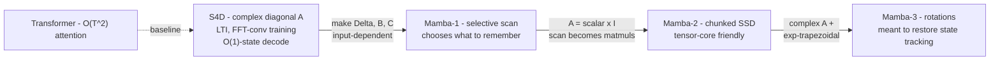
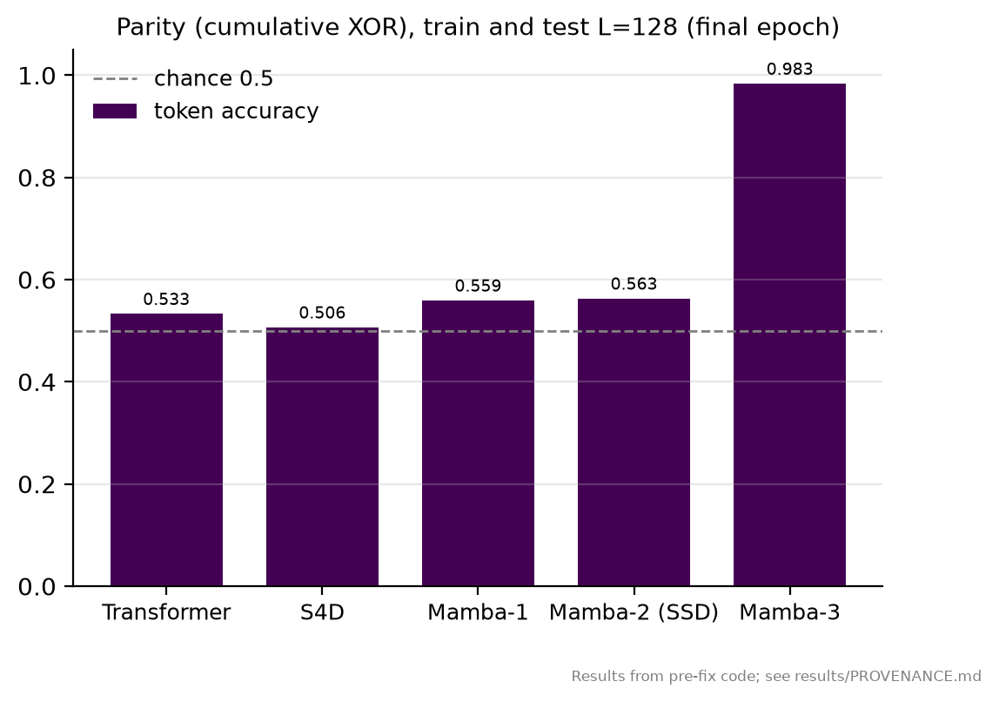
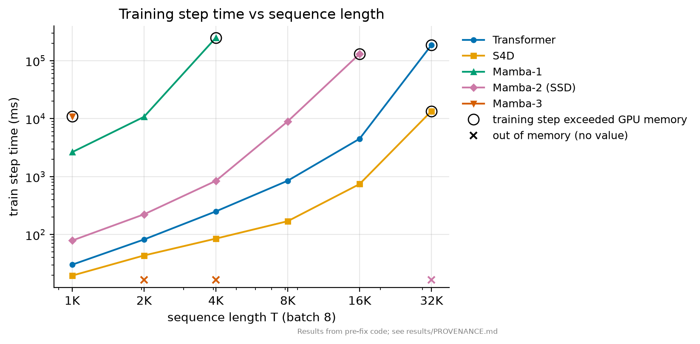
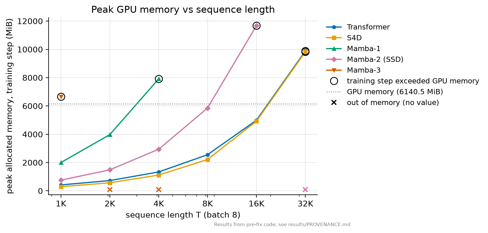
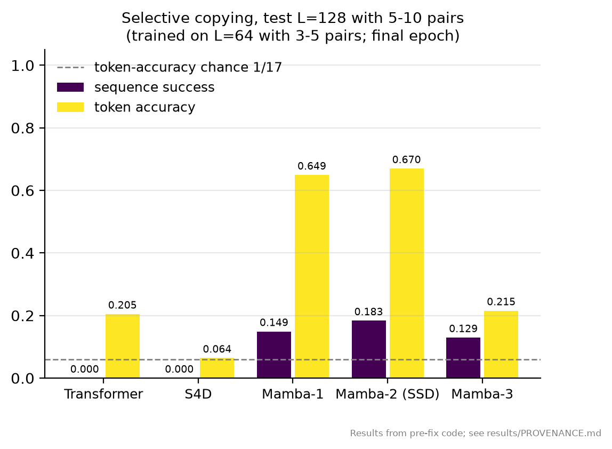
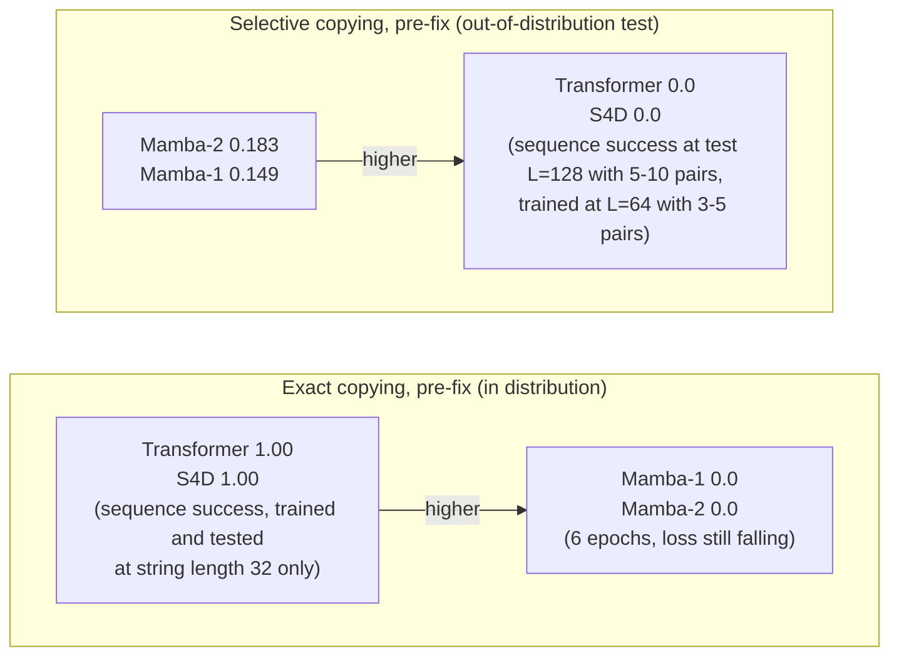
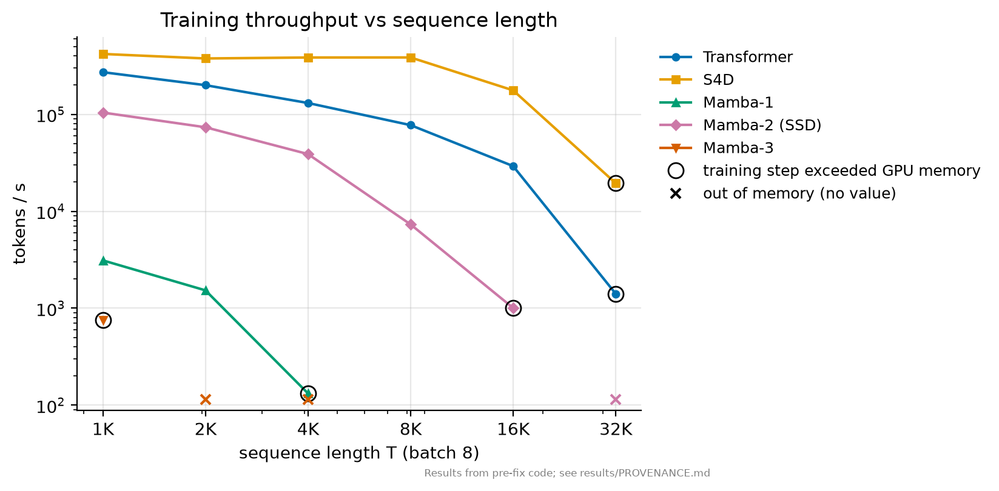
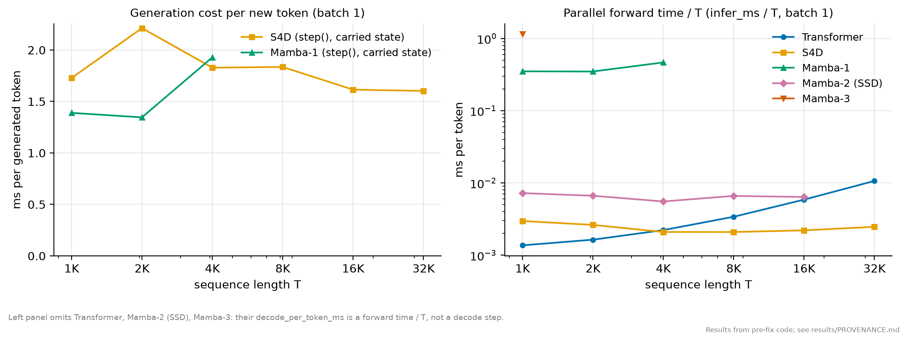
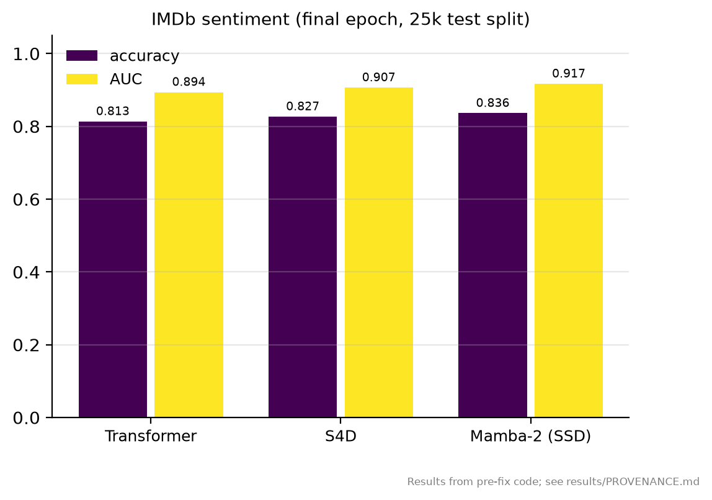
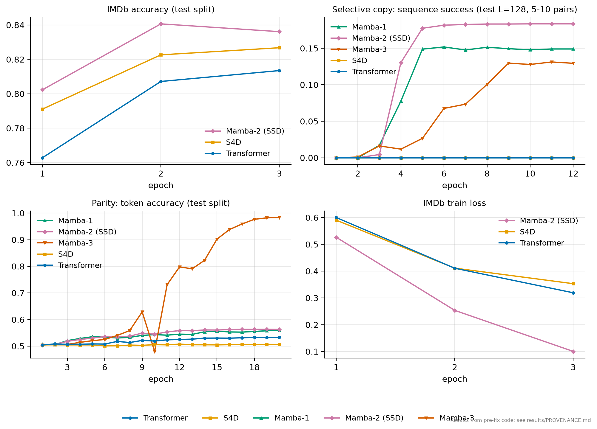

# Efficient Long-Context Sequence Modeling: From S4 to Mamba-3

[](https://github.com/vaibhav3000/s4-to-mamba/actions/workflows/ci.yml)

An experimental study of how efficient sequence architectures evolved from
S4 through Mamba, Mamba-2 and Mamba-3, and what trade-offs emerge in quality,
latency, memory and state-tracking capability. Everything is implemented in
pure PyTorch from first principles. Every committed number was measured on one
laptop GPU (RTX 4050 Laptop, 6 GB) with code from before the fixes described
under [Status of the committed results](#status-of-the-committed-results), and
five of the efficiency points ran only because Windows let them spill past the
card's memory into system RAM. `scripts/make_figures.py` draws every figure in
`figures/` and the report figures in `reports/figures/` from the committed JSON.

**Headline result (pre-fix code, one seed).** On cumulative parity at length
128, the Mamba-3 recurrence, whose complex transitions depend on the input,
reached **98.3% token accuracy** (42% of sequences fully correct), while
Mamba-2, Mamba-1, S4D and a Transformer ended between 50.6% and 56.3%, close to
the 50% chance level. S4D also has complex transitions (fixed, not
input-dependent), and this Mamba-3 differs from Mamba-2 in more than its
transitions, so the run does not isolate the cause (see section 1). On
selective copying, scored on longer test sequences with up to twice as many
pairs as training showed, LTI S4D stayed near chance (**6.4%** token accuracy)
while the best selective SSM, Mamba-2, reached **67%** and Mamba-3 reached
21.5% (see section 2 for why the 67% is weaker evidence of selectivity than it
looks).

## Status of the committed results

Every number, table and figure in this README, every result file in `results/`
and every plot in `figures/` comes from code that predates the correctness
fixes on this branch, and so do the numbers quoted in `reports/` and `docs/`.
None of it has been re-run yet. The S4D, Mamba-1, Mamba-2 and Mamba-3 task
results are all affected: each Mamba-2/3 head read only a slice of its group's
B and C instead of the full vectors, the S4D ZOH input matrix was missing its
1/z factor, weight decay was applied to the SSM dynamics parameters of S4D,
Mamba-1 and Mamba-3, and Mamba-2's chunked scan dropped the gradient of very
strong decays. The whole efficiency sweep is affected too, Transformer
included: the timed train step had no LM head, the Transformer decode values
come from older code that divided one forward pass by T, the Mamba-2/3 decode
values are prefill time divided by T, S4D's `step()` recomputed its
discretization on every token, and five points ran only because Windows
spilled GPU memory into system RAM. The Transformer's task results come from
code whose training behavior the fixes do not change, but they have not been
re-run either. The figures were redrawn from the same JSON with honest labels
(no number changed). [results/PROVENANCE.md](results/PROVENANCE.md) records
where each result file came from and how to regenerate it on the GPU.

Where the committed results came from: the parity, selective-copy and IMDb
results were produced with the code of b327a35 (the Mamba-2 IMDb file was
committed later, in bcc3f7d), the efficiency sweep with versions from b327a35
to bcc3f7d (it was stitched together from eight processes, several of them
running uncommitted code), and the exact-copy results with 246f4cb. They are stale after these fixes: P1 Mamba-2/3
B/C head expansion (0a2461a), P2 S4D ZOH (1751001), D10 weight decay on SSM
dynamics parameters (dcb4dd1), D17 Mamba-2 chunked log decay (52f53bf) and P16
the LM head in the timed train step (0b58559); P6 (8d15605) makes every
`peak_gpu_mb` after the first model of a process an inherited value. The
Transformer task metrics are not changed by any fix but come from the same
runs.

### Re-running every result on the GPU

From the repository root in PowerShell, with no other job on the GPU and
`CUDA_VISIBLE_DEVICES` unset (results/PROVENANCE.md has the pre-flight checks
and the Git Bash version):

```powershell
uv pip install --no-deps -e . --python .venv\Scripts\python.exe
.\.venv\Scripts\python.exe -m pytest -q
.\.venv\Scripts\ssmbench-train.exe --config configs/parity.yaml --out results --device cuda
.\.venv\Scripts\ssmbench-train.exe --config configs/selective_copy.yaml --out results --device cuda
.\.venv\Scripts\ssmbench-train.exe --config configs/imdb.yaml --out results --device cuda
.\.venv\Scripts\ssmbench-train.exe --config configs/exact_copy.yaml --out results --device cuda
Remove-Item -LiteralPath results\efficiency_gpu.json
.\.venv\Scripts\ssmbench-efficiency.exe --config configs/efficiency.yaml
.\.venv\Scripts\python.exe scripts/make_figures.py
.\.venv\Scripts\python.exe demo-site/build.py
```

The stale efficiency file must be removed first: the benchmark refuses to
resume into entries measured with other code, and `--force` would merge them.
Then update the numbers typed into this README, the docs and
`reports/Efficient_Sequence_Modeling_S4_to_Mamba3.tex`, and rebuild the report
with `latexmk -pdf` in `reports/`.

## Evolution at a glance



**Parity / state tracking (pre-fix run, one seed):** only Mamba-3, whose
complex transitions depend on the input, ends far above the 0.5 chance line;
the other four end between 0.506 and 0.563 token accuracy.



**Train step time vs sequence length (pre-fix sweep, batch 8, fp32, no LM head
in the timed step; the models differ in size, and five points spilled past GPU
memory, see section 5):**



**Peak allocated memory in the train step (pre-fix sweep; x markers = runs
recorded as out of memory, rings = points that exceeded the card's memory).** The card holds 6 140.5 MB, so the five points
above that level (Transformer and S4D at 32K, Mamba-2 at 16K, Mamba-1 at 4K,
Mamba-3 at 1K) ran only because Windows spilled GPU memory into system RAM.
Mamba-1 stops at 4K because `configs/efficiency.yaml` caps it there; no
Mamba-1 run was recorded as out of memory. Reserved memory was not recorded.



**Selective copying (pre-fix run, one seed, final epoch, scored on length-128
test sequences with 5 to 10 pairs after training on length 64 with 3 to 5
pairs; see section 2):**



## Why this matters

Efficient sequence modeling is the main alternative to quadratic attention for
long context. Understanding it requires more than importing `mamba-ssm`: the
interesting questions - what is the state, what makes Mamba selective, why did
Mamba-2 move to a matmul form, what does complexity in Mamba-3 buy - are only
answerable if the recurrence is written down and tested. This repository is
that exercise, with benchmarks attached.

## The five implementations (src/ssmbench/models/)

| model | transition A | discretization | training form | decode |
|---|---|---|---|---|
| `transformer_minimal` | - (absolute sinusoidal positions, no RoPE or ALiBi) | - | causal SDPA attention, run in fp32 (so no flash kernel) | full-prefix recompute (no KV cache, labeled) |
| `s4_minimal` (S4D) | complex diagonal, HiPPO-style init | ZOH with exact (e^z-1)/z | FFT convolution, O(T log T) | O(1)-state complex `step()` |
| `mamba_minimal` | real negative diagonal, input-dependent | exponential-Euler: exp(dA), dB | python-loop selective scan | true incremental `step()`, O(1) state |
| `mamba2_minimal` | scalar-per-head x I | exponential-Euler | **chunked SSD** matmuls + carried (N,P) state | no `step()`; the benchmark reports prefill time / T, not a decode cost |
| `mamba3_minimal` | **complex** diagonal per (head, state): learned static frequency theta, so the rotation angle delta_t x theta depends on the input only through delta_t | **exponential-trapezoidal** (data-dependent lambda) | python-loop selective scan | no `step()`; the benchmark reports prefill time / T, not a decode cost |

The table describes the code after the fixes on this branch: S4D's ZOH now
includes the 1/z factor, and every Mamba-2/3 head reads its group's full B and
C. The committed results were produced before those fixes (see
[Status of the committed results](#status-of-the-committed-results)).

Correctness is tested against independent references (`tests/`, 127
tests). `tests/test_references.py` compares each efficient form with a slow
float64 or complex128 loop written from the equations: S4D's ZOH against the
matrix exponential, its convolution kernel and conv-vs-step path at T=2100
(three kernel chunks), Mamba-2 and Mamba-3 blocks with one and two B/C groups
(Mamba-3 at random theta and lambda), and chunked against sequential Mamba-2
through `forward()`, plus float64 gradient checks of each scan and of the S4D
layer. The older checks in `tests/test_models.py` (S4D conv vs step at T=64,
Mamba-2 chunked vs sequential on random scan inputs, Mamba-3 at lambda=1 and
theta=0, Mamba-1 step vs forward, all at atol = rtol = 1e-3) passed on the
pre-fix code even though it had the B/C and ZOH bugs, and none of them reached
the multi-chunk S4D kernel used above T=1024. A concatenation bug in that
kernel was found by the efficiency sweep, not by a test; the T=2100 tests now
cover that path.

## Experiments and results (results/*.json)

### 1. Parity (state tracking): the Mamba-3 motivation, one pre-fix run

Cumulative XOR over L=128; the target at position t is the parity of inputs
1..t. Real non-negative transitions can only decay; they cannot rotate state,
which parity requires. Setup: 2 000 training sequences, training and test both
at length 128 (no length extrapolation), 20 epochs, one seed (42), matched
width and depth (d_model 64, 2 layers) but not matched parameter counts
(33 794 for S4D up to 100 354 for the Transformer). Results from pre-fix code:

| model | token accuracy | full-sequence success |
|---|---|---|
| **mamba3** (complex, input-dependent) | **0.983** | **0.42** |
| mamba2 | 0.563 | 0.0 |
| mamba | 0.559 | 0.0 |
| transformer | 0.533 | 0.0 |
| s4d | 0.506 | 0.0 |

S4D has complex transitions too, but LTI ones (a fixed rotation per step, not
input-dependent). The usual explanation for its failure is that the rotation
has to respond to each bit; this run does not test that directly. Nor does it
isolate complex transitions as the reason Mamba-3 succeeds. Besides its complex
transitions (a learned static frequency theta, scaled by the input-dependent
step delta), this Mamba-3 differs from Mamba-2 in its decay (a vector per head
and state instead of one scalar per head) and in its trapezoidal update with an
input-dependent lambda, and no run with theta fixed at 0 or lambda fixed at 1
was trained. The Mamba-3 curve also dropped to 0.480 token accuracy at epoch 10
before reaching 0.983, and with one seed there is no estimate of run-to-run
spread. Every SSM run here predates the fixes: the S4D run used the ZOH input
matrix without its 1/z factor, the Mamba-2 and Mamba-3 runs had the B/C
head-expansion bug, and S4D, Mamba-1 and Mamba-3 had weight decay on their SSM
parameters.

### 2. Selective copying (pre-fix, one seed, out-of-distribution test only)

Marker-value pairs embedded in noise; the model must emit the remembered
values after a separator. Train L=64 (3-5 pairs), test L=128 (5-10 pairs),
12 epochs, one seed. Every number below is from that out-of-distribution test
set; no in-distribution accuracy was recorded. Training never shows more than
five pairs, and about two thirds of the answer tokens in this test set belong
to the first five pairs, so a model that recalls only the first five values
would score almost exactly Mamba-2's token accuracy. Training loss ended below
0.0005 while test loss stayed at 1.2 (Mamba-2) and 2.4 (Mamba-1), which is
consistent with fitting the training distribution rather than extrapolating
to more pairs. The Transformer uses absolute sinusoidal positions and never saw
a position beyond 64 in training. Results from pre-fix code:

| model | sequence success | token accuracy |
|---|---|---|
| mamba2 | **0.183** | **0.670** |
| mamba | 0.149 | 0.649 |
| mamba3 | 0.129 | 0.215 |
| transformer | 0.0 | 0.205 |
| s4d | 0.0 | 0.064 |

LTI S4D stays near chance (1 in 17 values), consistent with an LTI state that
cannot gate noise out. Mamba-2 and Mamba-1 recall part of the values, with the
first-five-pairs caveat above. Mamba-3, also a selective SSM, reaches only
0.215 token accuracy, although its training loss ended at 0.021, so it did fit
the training distribution. Why it falls further on the longer test is not
established: the idea that its rotations trade recall for state tracking was
never tested, and this run also had the B/C head-expansion bug and weight decay
on its decay and rotation parameters, both fixed on this branch. Reported as
measured, pending a re-run.

### 3. Two copy tasks, two rankings (not a like-for-like comparison)

"Copying" is not one task. Our selective copying (keep k pairs, filter noise)
and our exact copying (reproduce every token, a reduced version of the Jelassi
et al. ICML 2024 task) rank the models differently in the pre-fix runs below.
The two scores are not measured the same way: the selective-copy scores come
from an out-of-distribution test (length 128 with 5-10 pairs, after training on
length 64 with 3-5 pairs), while the exact-copy scores are in distribution, at
the single string length (32) used for every training example.



No single task establishes that one architecture universally dominates
another. Our results are benchmark-specific by design; see
docs/copy_task_comparison.md and docs/literature/. Both predate the fixes, so
any numbers they quote are the same pre-fix results, and where they say
exact-copy training used string lengths 5..32, every training string actually
had length 32.

### 4. IMDb sentiment (quality on real text)

Same protocol for every model: 12.5k training samples (fixed seed), max length
512, 3 epochs, d_model=128, 4 blocks, cosine schedule, one training seed (42).
Accuracy and AUC are from the final epoch on the full 25k IMDb test split,
which also served as the per-epoch validation set. Parameter counts are
3 353 602 (Transformer), 3 034 786 (Mamba-2) and 2 677 762 (S4D), most of it
the 20 000-word embedding. These rows predate the fixes (the B/C fix for
Mamba-2, the ZOH and weight-decay fixes for S4D; the Transformer is
unaffected), and with one seed the 0.9 to 2.3 point gaps have no error bars:

| model | accuracy | AUC |
|---|---|---|
| **mamba2** | **0.836** | **0.917** |
| s4d | 0.827 | 0.907 |
| transformer | 0.813 | 0.894 |

The python-loop sequential implementations (mamba, mamba3) were not trained on
IMDb at this scale because their scans are too slow at length 512 (see the
efficiency table below); experiments.log shows two Mamba-1 IMDb starts that did
not finish an epoch. The selective-SSM family is represented only by mamba2,
which keeps Mamba-1's exponential-Euler selective recurrence with a scalar
decay per head. Mamba-3 also changes the discretization (trapezoidal, with a
learned lambda) and makes the state complex, so this table says nothing about
it.

### 5. Efficiency vs sequence length (pre-fix sweep, RTX 4050 Laptop 6 GB)

`results/efficiency_gpu.json` holds per-model train-step latency, peak
allocated memory, training throughput and a per-token "decode" value, all
CUDA-event timed in fp32. Train steps use batch 8 and 5 timed repeats; the
inference and decode timings use batch 1, and decode only 2 repeats. The file
is one pre-fix sweep pieced together from several restarted runs while the
code was still changing. Its limits: the timed train step fed the backbone's
hidden features straight into the loss (no LM head); the Transformer decode
values were recorded by older code as forward time divided by T, the
Mamba-2/3 values are prefill time divided by T, and S4D's `step()` recomputed
its discretization on every token, so the decode values do not compare
per-token decode costs; only allocated memory was recorded, not reserved; and
the models differ in size (Transformer 1 579 520 parameters, S4D 182 784 with
no MLP, Mamba-1/2/3 between 875 808 and 877 872). Only the Transformer and S4D
cover the whole 1K to 32K range. Train step time, batch 8 ("spilled" = peak
allocation above the card's 6 140.5 MB, so the run paged into system RAM):

| T | Transformer | S4D (FFT) | Mamba-2 (chunked) | Mamba-1 (loop) |
|---|---|---|---|---|
| 1024 | 30 ms | 20 ms | 79 ms | 2 632 ms |
| 4096 | 250 ms | 85 ms | 842 ms | 248 138 ms (spilled) |
| 16384 | 4 482 ms | 741 ms | 130 426 ms (spilled) | not run (capped at 4096 by config) |
| 32768 | 186 025 ms (spilled) | 13 456 ms (spilled) | OOM | not run (capped at 4096 by config) |

What the measurements show, stated plainly:

- The Transformer's O(T^2) compute is visible in wall-clock even with
  memory-efficient attention: 30 ms at 1K becomes 4 482 ms at 16K. The 186 s
  at 32K is not a clean attention measurement: that run allocated more memory
  than the card holds and paged into system RAM.
- S4D's FFT-convolution form has the lowest train step time at every measured
  length (at 16K, 741 ms against 4 482 ms for the Transformer, about 6x). It is
  also by far the smallest model (182 784 parameters against 1 579 520, and no
  MLP), and everything runs in fp32 without autocast and with TF32 matmuls left
  off, so this is not a size-matched or mixed-precision comparison.
- The educational python-loop scans are O(T) in operations but far slower in
  wall-clock than the vectorized forms at the same length: at 1K a Mamba-1
  train step took 2 632 ms against 79 ms for chunked Mamba-2 and 20 ms for S4D,
  and a Mamba-3 step took 10 880 ms (a run that also spilled past GPU memory).
  The constant overhead (kernel launches, T-step autograd graphs) is why fused
  kernels exist, and why Mamba-2 moved to a matmul formulation.
- Out-of-memory runs are recorded, not hidden: Mamba-2 training at 32K and
  Mamba-3 training at 2K carry `oom_train: true`, and Mamba-3 at 4K carries
  `oom: true`. No Mamba-1 entry is an OOM: Mamba-1 was measured at 1K, 2K and
  4K and not run beyond, because `configs/efficiency.yaml` caps Mamba-1 and
  Mamba-3 at 4096. Five measured points allocated more than the card's
  6 140.5 MB (Transformer and S4D at 32K, Mamba-2 at 16K, Mamba-1 at 4K,
  Mamba-3 at 1K). Windows WDDM let them spill into shared system memory, so
  their timings include that paging; on Linux, or with the fallback disabled,
  they would be expected to fail with OOM instead (not tested). Since only
  allocated memory was recorded, the sweep cannot show whether the 16K
  Transformer and S4D points (about 5 GB allocated) also spilled.

### 6. The wall-clock lesson (the honest part)

The minimal Mamba-1/3 scans are O(T) in operations but slow in wall-clock:
a python loop over T steps x n_layers launches thousands of tiny kernels and
builds a T-step autograd graph. The chunked Mamba-2 form cuts the loop by
`chunk_size` and turns the inner work into matmuls, the kind of work tensor
cores speed up in bf16 or TF32. This benchmark runs fp32 without autocast and
with TF32 matmuls left off, and in it chunked Mamba-2 is slower than the
Transformer at every measured length (79 ms vs 30 ms at 1K, 842 ms vs 250 ms at
4K, pre-fix). The official repository goes further with fused Triton/CUDA
kernels (Linux-only, not used here). Theoretical complexity and wall-clock
performance are different claims, and this repository measures both.

## Literature Comparisons

**Repeat After Me (Jelassi et al., ICML 2024): Transformers beat SSMs at
copying.** We rebuilt a reduced version of their exact-copy task
(`<bos> string <sep>` -> reproduce the string) in pure PyTorch and ran our
baseline grid on it. Three simplifications matter: every training string has
length 32, so the answer is always the prompt shifted by 33 positions; the
answer positions are fed PAD rather than the previous target token; and each
model trained for 6 epochs with one seed. Measured with pre-fix code
(full-sequence success at the training length L=32): Transformer 1.00, S4D
1.00, Mamba-1 0.00, Mamba-2 0.00. This is weak evidence for the paper's
Transformer-over-SSM result. The LTI S4D, itself an SSM, matches the
Transformer. The Mamba-1 and Mamba-2 validation losses (3.09 and 2.81) were
still falling after 6 epochs and sit not far below ln 26, the loss of uniform
guessing over 26 letters, so their 0.00 looks more like under-training than a
measured state-capacity limit; the Mamba-2 run also had the B/C head-expansion
bug. Parameter counts differ too (602 782 Transformer, 363 670 Mamba-2,
358 174 Mamba-1, 95 902 S4D). Beyond the training length (L=64/128) every
model collapses, the Transformer included; ours uses absolute sinusoidal
positions, the kind the paper reports failing to extrapolate (their ALiBi
variant did).

- Research note (pre-fix; it says training used string lengths 5..32, but
  every training string had length 32): docs/literature/repeat_after_me_reproduction.md
- Task comparison (pre-fix, same length caveat): docs/copy_task_comparison.md
- Figures (pre-fix): figures/fig_exact_copy.png (its x-axis label says
  'train: 5 to 32', but every training string had length 32; its chance line
  is 1/30, uniform over all 30 output classes, while guessing among the 26
  letters would give 1/26), figures/fig_task_formulation.png (puts
  out-of-distribution selective-copy scores beside in-distribution exact-copy
  scores)
- Interview framing: docs/literature/interview_defense.md
- Analysis notes (no reproduction claimed): LongMamba
  (docs/literature/longmamba_analysis.md), PD-SSM
  (docs/literature/pd_ssm_analysis.md)

## Technical Report

A concise IEEE-style technical paper documenting this study is at
[reports/Efficient_Sequence_Modeling_S4_to_Mamba3.pdf](reports/Efficient_Sequence_Modeling_S4_to_Mamba3.pdf),
with its LaTeX source under `reports/`. It was written before the fixes on
this branch and quotes the same pre-fix numbers, now marked as such. The PDF is
rebuilt from the .tex, and its figures in `reports/figures/` are drawn by
`scripts/make_figures.py` from the committed JSON.

## What is NOT implemented (and why that is stated)

- Full S4 (NPLR parameterization, Woodbury-corrected Cauchy kernel): S4D keeps
  every idea this study needs; the delta is documented in docs/evolution.md.
- Fused/official kernels: this repo is dependency-light pure PyTorch; the
  official `mamba-ssm` requires Linux and CUDA compilation.
- Mamba-3's MIMO formulation and its chunked dual: the recurrence, complex
  states and trapezoidal discretization are implemented; the parallel form is
  described in docs/evolution.md.
- Choices in this Mamba-3 that are easy to miss: its rotation frequency theta
  is a learned static parameter, so the rotation angle varies with the input
  only through the step size delta; its decay A is a vector per (head, state),
  where Mamba-2 uses one scalar per head; and the readout uses only the real
  part of the state (y = C^T Re(h)).
- Incremental decode for Mamba-2 and Mamba-3: neither has a `step()` method,
  so the benchmark's per-token "decode" value for them is prefill time divided
  by T.
- Relative position schemes for the Transformer: it uses absolute sinusoidal
  positions (no RoPE or ALiBi), a known weakness on test sequences longer than
  the training ones, which the selective-copy and exact-copy tests use. Its
  attention also runs in fp32, which rules out the flash kernel.

## Reproducibility

```bash
python -m pip install -e ".[dev]"        # torch required (CPU or CUDA)
python -m pytest tests/ -q               # 127 tests
ssmbench-train --config configs/parity.yaml --out results
ssmbench-train --config configs/selective_copy.yaml --out results
ssmbench-train --config configs/exact_copy.yaml --out results
ssmbench-train --config configs/imdb.yaml --out results
ssmbench-efficiency --config configs/efficiency.yaml
python scripts/make_figures.py           # figures/ and reports/figures/ from results/
```

`scripts/run_training.py` and `scripts/run_efficiency.py` still work with the
same flags. The training configs pin one seed (42), the protocols and the model
sizes. The committed results are the pre-fix runs (see
[Status of the committed results](#status-of-the-committed-results) and
[results/PROVENANCE.md](results/PROVENANCE.md)). `ssmbench-efficiency` writes
to the `out_path` in `configs/efficiency.yaml` (`results/efficiency_gpu.json`)
and resumes into it only if the existing entries come from the same code, torch
build, GPU, batch size and repeat count; otherwise it stops unless you pass
`--force`. For a clean sweep, move the committed file aside first rather than
forcing a merge. Because results are committed, the figures can be rebuilt
without a GPU.

## Project structure

```
src/ssmbench/models/     five backbones + shared blocks + registry
src/ssmbench/data/       IMDb pipeline; selective copy; parity
src/ssmbench/train/      config-driven trainer, JSON results
src/ssmbench/benchmarks/ sequence-length efficiency harness
configs/                 experiment YAMLs
tests/                   reference, equivalence, gradient, shape and determinism tests
results/                 committed experiment outputs (JSON, pre-fix; see results/PROVENANCE.md)
figures/                 plots generated from results/ (PNG + PDF, pre-fix)
docs/                    evolution.md, interview_guide.md
legacy/                  the original project's scripts, preserved with notes
```

## References

See REFERENCES.md. Primary: S4 (arXiv 2111.00396), S4D (2206.11893), HiPPO
(2008.07669), Mamba (2312.00752), Mamba-2 (2405.21060), Mamba-3 (2603.15569).
The official state-spaces/mamba repository (Apache-2.0) was consulted for
parameterization conventions; no code was copied.

## License


MIT.


## Visual Benchmark Results (pre-fix)

Every plot here comes from the pre-fix results described under
[Status of the committed results](#status-of-the-committed-results).

| Train step time (forward, backward, optimizer step; only Transformer and S4D reach 32K) | Peak allocated GPU memory in the train step (points above 6 140.5 MB spilled into system RAM) |
| :---: | :---: |
|  |  |

| Training throughput (tokens/s) | Left: generation cost per token for the models with a real `step()` decode (S4D, Mamba-1). Right: forward time / T for every model, which is not a decode cost |
| :---: | :---: |
|  |  |

| Cumulative parity (one seed) | Exact copy by string length (every training string has length 32) |
| :---: | :---: |
|  |  |

| IMDb accuracy and AUC (one seed) | Learning curves (IMDb, selective copy, parity) |
| :---: | :---: |
|  |  |

## Running the tests in Docker

The image installs the package and runs the test suite (127 tests, on
CPU). It does not reproduce any training or benchmark result. Each test states
its own tolerance: the float32 parallel-vs-recurrent checks in
`tests/test_models.py` use atol = rtol = 1e-3, and the reference checks in
`tests/test_references.py` use 1e-10 for most float64 comparisons and 1e-4 for
float32 against a float64 reference.

```bash
docker build -t s4-to-mamba .
docker run --rm s4-to-mamba
```
