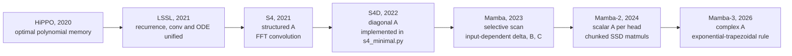
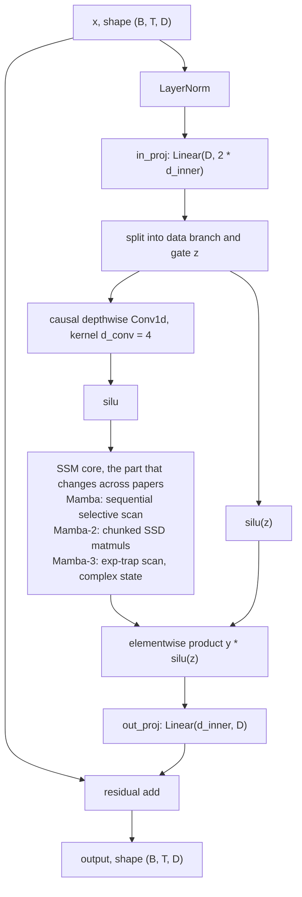
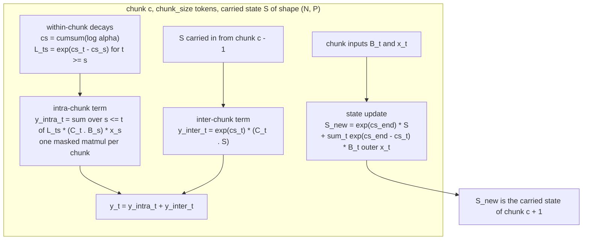

# From S4 to Mamba-3: how the state transition evolved

This repository (package `ssmbench`) implements five sequence model backbones from first
principles in pure PyTorch, each small enough to read top to bottom:

| File | Model | Role in this study |
|---|---|---|
| `src/ssmbench/models/transformer_minimal.py` | Causal Transformer | Quality and scaling baseline: pre-norm blocks, pinned SDPA backends (or the naive reference), sinusoidal or RoPE positions, KV-cache decode |
| `src/ssmbench/models/s4_minimal.py` | S4D | Diagonal restriction of S4: ZOH discretization, FFT-convolution training form, O(1)-state recurrent step form |
| `src/ssmbench/models/mamba_minimal.py` | Mamba-1 | Selective SSM: sequential scan training form plus a verified incremental `step()` decode |
| `src/ssmbench/models/mamba2_minimal.py` | Mamba-2 | Scalar-per-head transitions and the chunked SSD algorithm, verified against a sequential reference; O(1)-state `step()` |
| `src/ssmbench/models/mamba3_minimal.py` | Mamba-3 | Complex-valued transitions with exponential-trapezoidal discretization; chunked parallel form (complex SSD with a two-band correction) and `step()`, both verified against the recurrence |

The four SSMs share one skeleton (the Transformer baseline has no recurrence): a linear
first-order recurrence over a fixed-size state,

```
h_t = A_t h_{t-1} + B_t x_t,      y_t = C_t^T h_t
```

What changes across the papers is what `A_t` is allowed to be, how the continuous-time step is
converted to discrete time, and which equivalent computational form (convolution, scan, or
chunked matmul) runs on hardware. This document traces those choices in order. The equations
implemented in each file are checked by tests in `tests/test_models.py` and
`tests/test_references.py`, the second against independent float64 references written from
the equations. Every number cited is read from a committed result file in `results/`
(three run seeds per configuration; see `results/SUMMARY.md` and `results/PROVENANCE.md`).



## 1. S4 and S4D: the continuous-time template

### The model

S4 starts from a continuous-time linear state space:

```
h'(t) = A h(t) + B x(t),      y(t) = C^T h(t) + D x(t)
```

`A` encodes how past inputs decay and oscillate inside `h`. The HiPPO theory
(arXiv:2008.07669) supplies a specific structured `A` whose state holds the coefficients of an
orthogonal polynomial projection of the input history, which is a principled answer to "what
should a fixed-size memory contain". S4 initializes `A` from HiPPO and trains it.

Sequences are discrete, so the ODE is discretized with step size `delta`. Under zero-order
hold (the input is constant during one step):

```
Abar = exp(delta * A)
Bbar = A^{-1} (exp(delta * A) - I) B = delta * B * (e^z - 1)/z,   z = delta * A
```

The `(e^z - 1)/z` factor is the exact ZOH input integral, not an approximation. Our
`zoh_discretization` in `src/ssmbench/models/s4_minimal.py` computes it explicitly, with a
Taylor fallback near `z = 0` so the ratio stays finite as `delta * A` goes to zero. Earlier
code divided by 1 instead of `z` outside the Taylor branch, so `Bbar` came out as
`delta * B * (e^z - 1)`; the earlier single-seed S4D results (now only in the git history)
were produced with that error.

After discretization there are two equivalent forms:

- Convolution form (training): the output is a causal convolution with the kernel
  `K_k = sum_n C_n Bbar_n Abar_n^k`, computed with FFTs in O(T log T).
- Recurrent form (inference): step the recurrence with a (D, N) complex state, O(1) per token.

`test_s4d_conv_equals_recurrent` in `tests/test_models.py` runs both paths on the same
`S4DLayer` and requires agreement to 1e-3. This test is the definition of "the two forms are
the same model", but it cannot check the discretization itself: both paths take `Abar` and
`Bbar` from `zoh_discretization`, so an error there moves both together (the ZOH error above
passed it), and at T = 64 it stays inside one 1024-token kernel chunk.
`tests/test_references.py` adds the independent checks, in float64: `zoh_discretization`
against the matrix exponential of the augmented system in both branches of the
`(e^z - 1)/z` evaluation, the steady state against the continuous-time `-B/A`, the kernel
against a repeated-product reference at L = 2100 (three chunks), and the two forms against
each other at T = 2100.

### What we implement, plainly

We implement the **S4D diagonal restriction** (arXiv:2206.11893): `A` is complex diagonal, at
init `A_n = -1/2 + i * pi * n` (S4D-Lin; `S4D-Inv` is also available), with learnable real part
and imaginary part. Complex diagonal entries already allow rotation of the state, and the
S4D paper shows the diagonal case keeps essentially all of S4's quality at far less
complexity. The kernel uses the real part of the complex convolution.

Full S4 (the Normal-Plus-Low-Rank parameterization with the Woodbury-corrected Cauchy kernel)
is **referenced, not reimplemented**. It is the bridge from HiPPO to S4D, but its machinery
exists to handle a non-diagonal `A`; once `A` is diagonal the kernel collapses to a sum over
state channels, which is what `S4DLayer.kernel` computes directly, in chunks so the
`(chunk, D, N)` power tensor stays small.

## 2. Mamba: selectivity breaks the convolution form

Mamba (arXiv:2312.00752) makes the SSM a function of the content: `delta_t`, `B_t`, `C_t` are
projections of the current token, produced by `x_proj` and `dt_proj` in
`src/ssmbench/models/mamba_minimal.py`. The step size `delta_t` is the selectivity knob: after
`delta_t = softplus(dt_proj(...))` it is positive, and it sets the per-token timescale. Small
`delta_t` keeps the state almost unchanged (long memory); large `delta_t` overwrites the state
with the current token (forget and write).

This one change has two consequences that define everything after S4.

First, the convolution form dies. `K_k = C Bbar Abar^k` is a fixed kernel only because
`A, B, C, delta` are constants. Once they depend on the token, the system is time-varying: the
"kernel" that maps the input prefix to the output would itself depend on the entire input
sequence, so there is no fixed filter to convolve with. Training must run the scan. This is
the practical difference between an LTI system and a selective one, and it is why S4 has an
FFT path and Mamba does not.

Second, the discretization becomes exponential-Euler: the transition uses the exact
`alpha_t = exp(delta_t * A)` while the input uses the first-order `delta_t * B_t`. The Mamba-3
paper later formalizes exactly this rule in its Table 1. Our implementation follows the same
convention, including the log-uniform `dt` bias initialization in `[1e-3, 1e-1]` via the
inverse softplus, matching the official code (see REFERENCES.md for what was and was not
taken from it).

Note what `A` is at this point: a real negative diagonal. Therefore
`alpha_t = exp(delta_t * A)` lies in `(0, 1)` per entry: every transition only scales the
state down. Keep this in mind until Section 4.

The block around the scan is: `in_proj` to `2 * d_inner`, a causal depthwise convolution of
width `d_conv = 4`, `silu`, the selective scan, then a gate `y * silu(z)` and `out_proj`. The
short convolution restores cheap local token mixing that a state-only model lacks, and the
gate lets the network decide per channel how much of the SSM output passes. For inference,
`MambaBlock.step()` carries the state `h` of shape `(B, d_inner, N)` plus the last
`d_conv - 1` conv inputs, giving O(1) decode per token; `test_mamba_step_equals_forward`
verifies the step path reproduces the full-sequence forward path (itself a sequential
python-loop scan, not a parallel one) to 1e-3.



Mamba-2 and Mamba-3 reuse this block. S4D uses a simpler one (`S4DBlock` in
`s4_minimal.py`): `x + S4D(LN(x)) * silu(gate(LN(x)))`, with a learned `Linear(d_model,
d_model)` gate and no `in_proj`, short convolution or `out_proj`.

The scan itself is the honest weak spot of an educational implementation: the official Mamba
uses a fused parallel associative scan on GPU, ours is an explicit python loop over `T` steps.
The operation count is O(T), but the wall-clock is dominated by per-step overhead. That gap is
pedagogically the point (see Section 5), and it is also the practical motivation for Mamba-2.

## 3. Mamba-2: scalar transitions and State Space Duality

Mamba-2 (arXiv:2405.21060) restricts the transition to a scalar times the identity per head:
`A = a_h I` with learned `a_h < 0`. The decay becomes a scalar per head and per token,
`alpha_{h,t} = exp(delta_{h,t} * a_h)`, and the recurrence turns into a scalar-decayed linear
map. That restriction is what makes an algebraic unrolling possible: over a chunk of tokens,
the recurrence can be rewritten as a masked, decay-weighted quadratic form that looks like
attention. This is the State Space Duality (SSD): the same layer is both a recurrence (linear
in T, constant state) and an attention-like matmul (quadratic within a chunk, tensor-core
friendly).

In `src/ssmbench/models/mamba2_minimal.py`, per head `h` with head dimension `P` and state
size `N`, with `B` and `C` shared per group (`n_groups`):

```
within a chunk of length chunk_size, with cs = cumsum(log alpha) inside the chunk:

L_ts       = exp(cs_t - cs_s)  for t >= s        (decayed lower-triangular mask)
y_intra_t  = sum_{s <= t} L_ts * (C_t . B_s) * x_s      (attention-like matmul)
y_inter_t  = exp(cs_t) * (C_t . S)                      (carry-in from previous chunks)
S_new      = exp(cs_end) * S + sum_t exp(cs_end - cs_t) * B_t (outer) x_t
```

`y_t = y_intra_t + y_inter_t`. The only thing that crosses a chunk boundary is the `(N, P)`
state `S`. The chunk loop runs `T / chunk_size` iterations instead of `T`, and each iteration
is small matmuls. This is why Mamba-2 exists: tensor cores execute matmuls efficiently, not
long dependent chains of scalar operations, and the chunked form converts the scan into
matmul-shaped work. In this repository the chunk loop is plain PyTorch in float32 with no
fused kernel, and in the committed efficiency sweep Mamba-2 trains slower per step than
the Transformer with the memory-efficient attention kernel at every length both ran
(`results/efficiency/sweep_fp32.json` and `sweep_bf16.json`).

Implementation notes that matter numerically: the decay matrix is built in log space
from segment sums: for each pair (t, s) the sum of `log alpha` over (s, t] is accumulated
directly with a masked `cumsum` (as in the reference `ssd_minimal` segsum), and the upper
triangle is set to `-inf` before exponentiation. Nothing can overflow fp32 `exp`, no
difference of two large running sums loses precision after a strong decay, and the gradient
stays exact where a segment sum is zero. Sequences whose length is not a multiple of `chunk_size` are
padded. `log alpha` is `delta * A` itself, passed straight from `_scan_inputs`; earlier code
took the log of a clamped `exp(delta * A)`, which zeroed the gradient for very fast decays.
`Bx = delta_t * B_t` is precomputed as the state input, matching the exponential-Euler
input term. Each head reads its group's full `N`-vector of `B` and `C`
(`expand_groups_to_heads` in `blocks.py`). Earlier code gave each head only `N/H` entries,
each repeated, which cut Mamba-2's effective state per head to `N/H`; the earlier
single-seed Mamba-2 and Mamba-3 results (now only in the git history) came from that code.

Correctness is not asserted, it is tested:
`tests/test_models.py::test_mamba2_chunked_equals_sequential` runs `chunked_scan` and
`sequential_scan` on identical inputs for `chunk_size = 32` and `chunk_size = 64` (the latter
pads a misaligned length) and requires agreement to 1e-3. A failure there would mean the
algebraic unrolling is wrong, not that a kernel is slightly off; the chunked form is a
rearrangement of the same sum, so it must match to floating-point tolerance. That test feeds
random per-head inputs straight into the two scans, so it checks the unrolling but not how
`forward()` builds those inputs, and it passed while the head expansion of `B` and `C` was
wrong. `tests/test_references.py` closes that gap: it runs the whole block, in both scan modes
and with `n_groups = 1` and `2`, against a naive per-head float64 loop and compares parameter
gradients, compares the two scan modes through `forward()`, and asserts that every head reads
its group's full `B` and `C`.



## 4. Mamba-3: complex transitions and the exponential-trapezoidal rule

Mamba-3 (arXiv:2603.15569) changes three things relative to Mamba-2. Our
`src/ssmbench/models/mamba3_minimal.py` implements the first exactly, implements the second
with a static rotation parameter and the other details listed in 4.2, and describes the third.

### 4.1 Exponential-trapezoidal discretization

Mamba-1/2 inject the input at the right endpoint of each interval only (exponential-Euler).
Mamba-3 approximates the state-input integral with a data-dependent convex combination of
both endpoints:

```
h_t    = alpha_t h_{t-1} + beta_t B_{t-1} x_{t-1} + gamma_t B_t x_t
alpha_t = exp(delta_t * A_t)
beta_t  = (1 - lambda_t) * delta_t * alpha_t
gamma_t = lambda_t * delta_t
```

`lambda_t in (0, 1)` is predicted per token by a sigmoid gate (`lambda_proj`, zero-initialized
so training starts at the balanced `lambda = 1/2`). Setting `lambda = 1` recovers Mamba-1/2
exactly; `lambda = 1/2` is the classical trapezoidal rule; `lambda = 0` is the pure left
endpoint. The rule is second-order accurate in `delta` because the integrand `B(t) x(t)` is
sampled at both endpoints and the leading error term cancels. Note that `beta_t` carries the
factor `alpha_t`: the left-endpoint input must be decayed across the interval it is held over.

This is implemented exactly in `selective_scan`, with `prev_inject` carrying
`B_{t-1} x_{t-1}` between loop iterations. `test_mamba3_reduces_to_exp_euler` pins
`lambda = 1` and `theta = 0` (real transition) and requires the update to equal a hand-written
Mamba-1/2 exponential-Euler reference to 1e-3: the new rule must contain the old one as a
special case. At `lambda = 1` the `beta` term is zero and nothing rotates, so that test cannot
detect an error in `beta` or in the complex transition. `tests/test_references.py` covers
both: a naive complex128 loop at random `theta` and `lambda` in (0, 1) checks the block output
and, in float64, every parameter gradient; `lambda = 1` with nonzero `theta` must equal the
complex exponential-Euler update; and integrating `h' = a h + sin(t)` shows the end-point
error falling about 4x per halved step at `lambda = 1/2` and about 2x at `lambda = 1`, as
second- and first-order rules should.

### 4.2 Complex-valued transitions

The diagonal `A` becomes complex: `A = -exp(a_real) + i * theta` per (head, state), with
`theta` initialized to `pi * n` (S4D-Lin-style rotation frequencies). Three details of this
file matter when reading the results: `theta` is a static learned parameter, not computed from
the input, so the rotation per step (`delta_t * theta`) varies with the token only through
`delta_t`; the real decay `-exp(a_real)` is a vector per (head, state) rather than Mamba-2's
scalar per head; and `B` and `C` are real, with the readout `C^T Re(h)`. Two properties hold
at once:

- Stability: `|alpha_t| = exp(delta_t * Re(A)) < 1`, guaranteed by the negative real part.
  `test_mamba3_alpha_is_contractive_with_rotation` asserts this.
- Rotation: the phase `delta_t * theta` rotates the state in the complex plane.

The second property is the expressive one. A real non-negative transition can only decay or
grow the state; it cannot rotate. State-tracking problems whose answer depends on the order
and parity of events, of which cumulative XOR is the smallest example, require rotation-like
transitions. The Mamba-3 paper's discussion of expressivity (drawing on results of Grazzi et
al. on state tracking in recurrent models and Merrill et al. on the limits of real-valued
transitions) makes this argument formally; our parity benchmark is consistent with it, with the
caveats listed below the table.

On cumulative XOR (trained at L = 128 for 20 epochs, parameter-matched, three run seeds,
`results/train/parity/`), token accuracy in percent:

| Model | L = 128 | L = 2048 |
|---|---|---|
| Mamba-3 | 66.0 ± 20.1 | 51.1 ± 1.3 |
| Mamba-1 | 57.7 ± 3.1 | 50.6 ± 0.2 |
| Mamba-2 | 56.7 ± 3.8 | 50.5 ± 0.2 |
| Mamba-3, `theta = 0` | 55.8 ± 1.5 | 50.4 ± 0.1 |
| Transformer (sinusoidal) | 53.0 ± 0.7 | 50.2 ± 0.1 |
| Transformer (RoPE) | 51.6 ± 0.2 | 50.1 ± 0.0 |
| S4D | 50.7 ± 0.4 | 50.0 ± 0.1 |

Only Mamba-3 has a run that learns the task: one seed reaches 89.2%, the other two 52.7 and
56.2%. With the rotation removed (`theta = 0`) it falls back to the level of Mamba-1 and
Mamba-2, so the rotation is what made the successful run possible, but with three seeds the
effect is not reliable. Nothing extrapolates: at L = 2048 every model is within 1.1 points of
chance, including the successful Mamba-3 seed (52.6%).

S4D deserves its own sentence here: it also has complex `A`, and it still fails parity
(50.7%). Complexity of the transition is not sufficient; the transition
must also be input-dependent. S4D is LTI: `A, B, C, delta` are constants, the rotation is
fixed at initialization and training time, and the input only drives a fixed linear system
additively. Parity requires multiplying the state by a factor that depends on the current
bit, which no fixed linear system can do. Selectivity (Mamba) plus rotation (Mamba-3) is what
the task demands.

### 4.3 MIMO formulation (described, not implemented)

The paper reformulates the layer so multiple input and output channels share each state slot
(MIMO instead of SISO per head), improving quality without increasing decode latency. Our
implementation keeps the SISO-per-head structure of Mamba-2's SSD and does not implement the
MIMO formulation; the module docstring in `mamba3_minimal.py` says the same. The parallel form
is implemented: unrolling the recurrence folds the complex `alpha` inside the `beta` term into
the decay, leaving `h_t = sum_{s<=t} exp(A D_ts) (B_s x_s) W_ts` with real segment sums `D_ts`
and two-band input weights `W_ts = lambda_s delta_s + [s < t] (1 - lambda_{s+1}) delta_{s+1}`,
the paper's 1-semiseparable matrix composed with a 2-band matrix. `chunked_scan` computes it
per chunk and carries the state and the boundary input `B x` of the chunk's last token; the
derivation is in docs/design/step2.md section 3.4 and docs/adr/0002.

### Comparison at a glance

| Model | Transition A | Discretization | Training form | Inference state | Capability notes |
|---|---|---|---|---|---|
| Transformer (`transformer_minimal.py`) | n/a, softmax attention weights | n/a | Attention over all pairs, O(T^2) score compute, SDPA backend pinned per variant | KV cache, preallocated, growing linearly with T | Sinusoidal or RoPE positions; no fixed-size state |
| S4 (referenced, not reimplemented) | Dense structured (NPLR), HiPPO init | ZOH | FFT convolution with Woodbury-corrected kernel | O(DN) recurrent state | Long-range memory via HiPPO spectrum |
| S4D (`s4_minimal.py`) | Complex diagonal, S4D-Lin init `A_n = -1/2 + i pi n` | ZOH with exact `(e^z - 1)/z` factor | FFT convolution, O(T log T) | Complex `(B, D, N)`, O(1) per token | LTI: one fixed kernel; rotates but cannot re-time or filter per token |
| Mamba-1 (`mamba_minimal.py`) | Real negative diagonal `(d_inner, N)` | Exponential-Euler: `exp(delta A)` transition, `delta B` input | Sequential selective scan (python loop here) | `(B, d_inner, N)` plus conv history, O(1) per token | Selective: delta, B, C depend on the token; decay-only transitions |
| Mamba-2 (`mamba2_minimal.py`) | Scalar per head times identity, `a_h < 0` | Exponential-Euler per head | Chunked SSD matmuls (sequential reference also provided) | `(N, P)` per head plus conv history, O(1) per token (`step()`) | SSD duality; tensor-core friendly; decay-only transitions |
| Mamba-3 (`mamba3_minimal.py`) | Complex diagonal per (head, state), `-exp(a) + i theta`, with `theta` a static parameter | Exponential-trapezoidal: `beta_t = (1 - lambda_t) delta_t alpha_t`, `gamma_t = lambda_t delta_t` | Chunked complex SSD with a two-band correction (sequential reference also provided) | Complex `(N, P)` per head, the boundary input `B x` and conv history, O(1) per token (`step()`) | Selective plus rotation: state tracking; second-order accurate rule |

## 5. What we did and did not implement

### Implemented

- Five backbones from first principles in pure PyTorch, readable end to end, no compiled
  extensions.
- Both computational forms wherever they exist, with equivalence tests at 1e-3 in
  `tests/test_models.py`: FFT convolution versus recurrent steps for S4D
  (`test_s4d_conv_equals_recurrent`), chunked versus sequential SSD for Mamba-2
  (`test_mamba2_chunked_equals_sequential`, including a padded misaligned length), and
  full-sequence forward (itself a python-loop scan) versus incremental step for Mamba-1
  (`test_mamba_step_equals_forward`).
- A reduction test tying Mamba-3 back to Mamba-1/2 (`test_mamba3_reduces_to_exp_euler`, at
  `lambda = 1` and `theta = 0`) and a stability-plus-rotation property test
  (`test_mamba3_alpha_is_contractive_with_rotation`).
- Independent references in `tests/test_references.py`, written from the equations and run in
  float64 or complex128: matrix-exponential ZOH and the `-B/A` steady state for S4D, the S4D
  kernel and conv-versus-step across several 1024-token chunks, naive per-head loops for the
  Mamba-2 and Mamba-3 blocks (outputs and parameter gradients), the convergence order of the
  Mamba-3 rule, float64 gradchecks of every scan, and a seeded-rebuild determinism check.
- One decode interface on every backbone (`init_state`, `prefill`, `step`): the parallel
  form over a prompt returns the state a recurrence would hold, and `step` continues it with
  O(1) state for the SSMs and a KV cache for the Transformer. tests/test_decode.py checks in
  float64 that prefill plus steps reproduces `forward` for every backbone.
- Three-seed results for parity (with a `theta = 0` ablation and length extrapolation),
  selective copying in and out of distribution, exact copying at a fixed and at variable
  lengths, and IMDb, with parameter-matched models; training, inference, numerics and
  compile benchmarks. All of them come from `scripts/run_gpu_plan.py` and are summarized in
  `results/SUMMARY.md`.

### Not implemented

- Fused kernels. The official Mamba selective-scan CUDA kernel and the official Mamba-2
  Triton chunk kernels are not used or reimplemented. Mamba-1's scan is a python loop over
  time; Mamba-2 and Mamba-3 loop over chunks (Mamba-3 keeps its sequential recurrence as the
  tested reference).
- Full S4. The NPLR parameterization and the Woodbury-corrected Cauchy kernel are referenced,
  not reimplemented; only the S4D diagonal restriction exists here.
- Mamba-3 MIMO. We implement the SISO recurrence and its chunked parallel form, with a static
  rotation parameter `theta` (see 4.2); the MIMO formulation is described only.
- Parallel (associative) scan for Mamba-1 and the hardware-aware per-sequence `dt` scaling
  from the Mamba paper.

### The cost of honesty

Our loops are O(T) in operations but slow in wall-clock: in eager-mode PyTorch, every
loop iteration launches small kernels and the launch overhead dominates. The gap shows in
the `wall_time_seconds` field of every run file: on parity, a run takes 26 to 50 s for the
chunked Mamba-2, 208 to 442 s for the python-loop Mamba-1 and 302 to 341 s for the chunked
Mamba-3, whose per-slot decay tensors make each chunk much heavier than Mamba-2's. The
training sweep in `results/efficiency/` shows the same: Mamba-1 needs 4.1 s
per step at T = 1K, Mamba-3 0.68 s and Mamba-2 62 ms. This is pedagogically the point: it
makes the difference between asymptotic operation counts and wall-clock time tangible, and
it is exactly why fused selective-scan kernels and the chunked SSD formulation exist.

### Reproducing the numbers

```
uv run python scripts/run_gpu_plan.py --seeds 0 1 2
```

runs every training config with three seeds and every benchmark, logging each job to
`results/logs/`; `ssmbench-train --config configs/<task>.yaml --out results/train --seeds 0 1 2`
runs one config. Each run writes one file per seed with its full config and hash, the
validation history, the final test evaluations, parameter count, per-run peak GPU memory, a
spill flag and wall time. Mamba-1 is not trained on IMDb because its python-loop scan is too
slow at L = 512 on this GPU (`configs/imdb.yaml`). Treat nothing as claimed that is not in a
committed result file (`results/PROVENANCE.md`).
